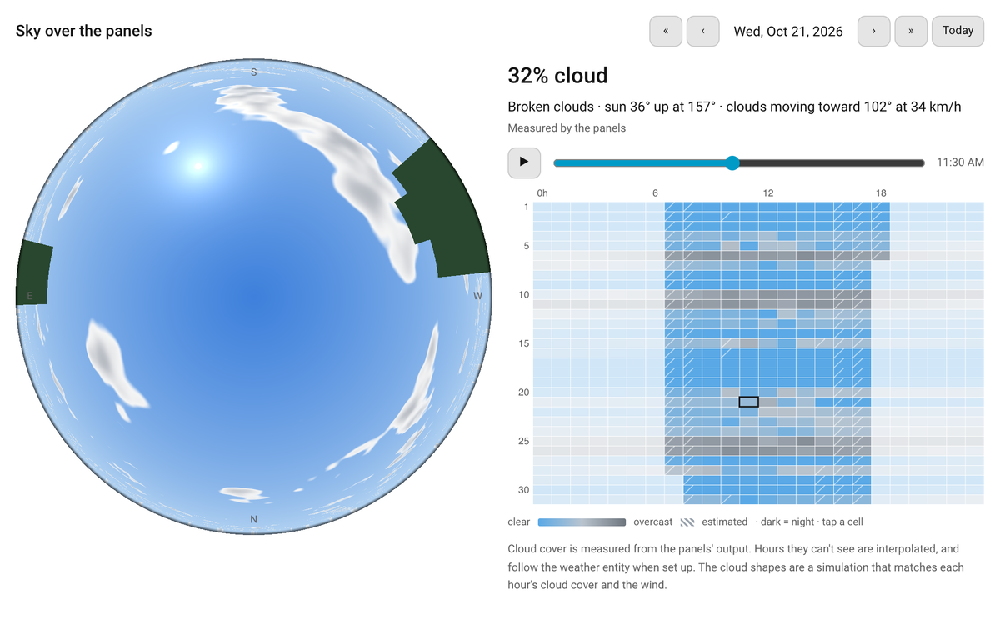
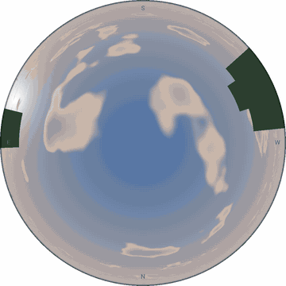
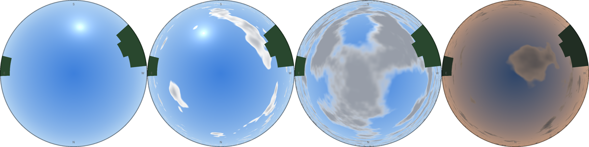
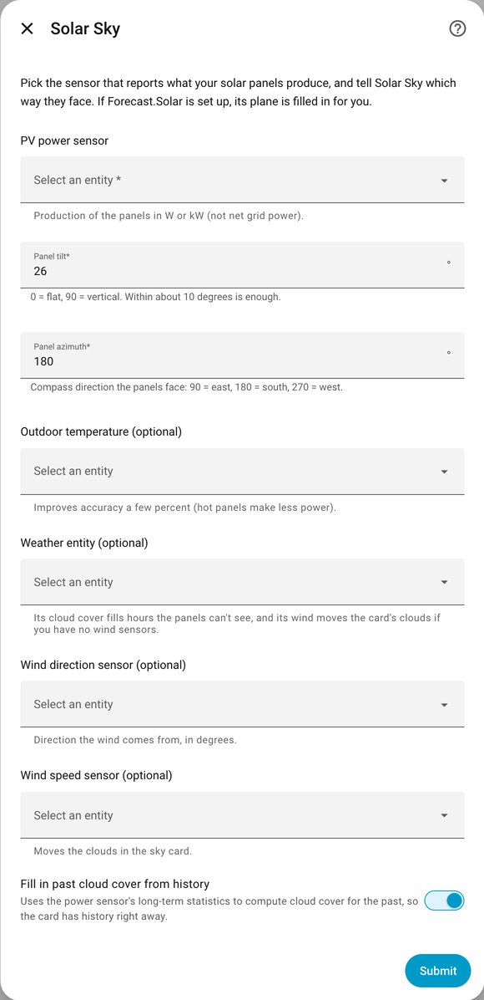
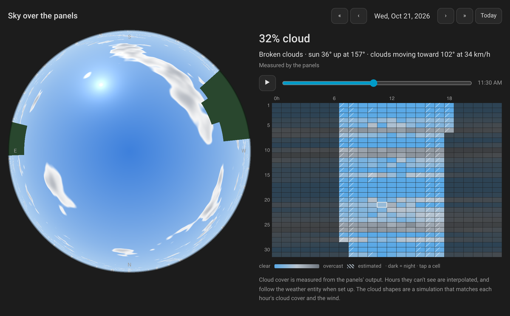
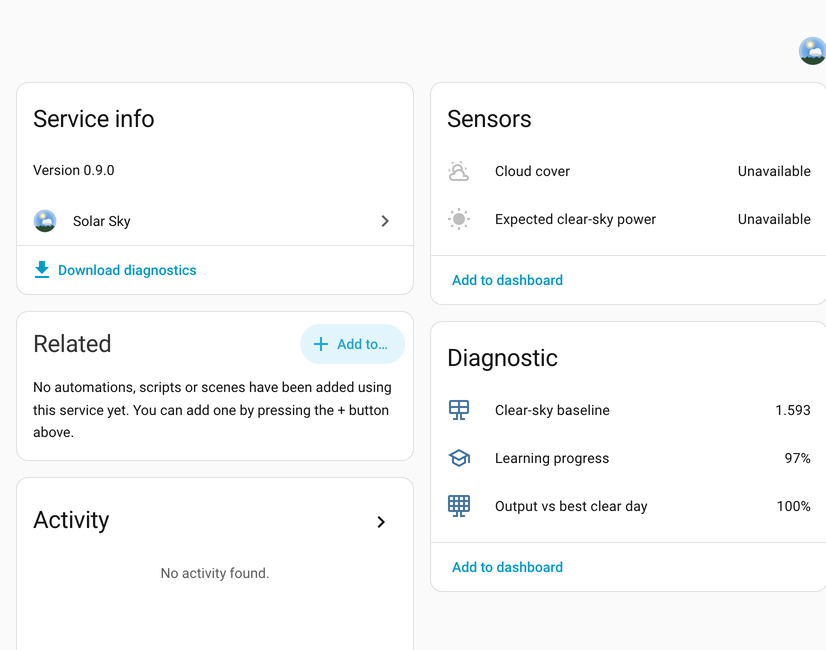

# Solar Sky

Your solar panels already measure the sky. Solar Sky turns their output into a **cloud cover sensor** for Home Assistant, and adds a dashboard card that **simulates a replays the sky over your roof**, hour by hour, for every day in your history.



<p align="center"></p>

It needs no weather station, no camera and no cloud service. It runs entirely on a solar power sensor and your Home Assistant location.

## What you get

- **Cloud cover** (%): the share of clear-sky sunlight that isn't reaching your panels right now. It updates every 5 minutes. Haze, smoke, or other obstructions register as clouds.
- **Expected clear-sky power** (W): what the panels would make right now under a clear sky.
- **Output vs best clear day** (%): today's clear-sky output compared with the best this year. Declines in performance could be dirt or inverter deterioration. Rain or cleaning the panels may increase output and the calculator will re-baseline.
- **A sky card**: an all-sky fisheye view with the sun, clouds that simulated the measured cover, and your own horizon where the sun isn't hitting the panels. It also has a month grid of every hour, and a timelapse player.
- **History from day one.** On setup, Solar Sky computes cloud cover for as far back as your power sensor's long-term statistics go, so the card isn't empty while it learns.

<p align="center"><br><sub>Clear, broken cloud, mostly cloudy, dusk. The dark shapes on the right and left are the tree line and a building, which Solar Sky finds on its own based on panel measurements.</sub></p>

## How it works

For every 5-minute window, Solar Sky compares what the panels made with what they *would* have made under a clear sky:

```
clear-sky index = measured power / (baseline × physics model × learned correction)
cloud cover     = (1 − min(index, 1)) × 100 %
```

- **Physics model.** Sun position, clear-sky irradiance (Ineichen-Perez), irradiance on your panel plane, glass reflection losses and cell temperature. These are numpy re-implementations of the standard [pvlib](https://pvlib-python.readthedocs.io) models, checked against pvlib to within 0.04° and 0.2 %.
- **Learned correction.** One value per 2° × 2° patch of the sky the sun passes through, taken from the days Solar Sky recognizes as clear. It absorbs everything specific to your roof: trees, chimneys, neighboring buildings, local haze, and small errors in inputted panel tilt. (The sensor is unavailable if the determination is made that it's mostly blocked.)
- **Baseline.** The clear-sky output scale. It follows clear days up immediately (after rain or a cleaning) and drifts down at most 1 % per clear day (as dirt builds), so soiling and panel aging don't read as increasing cloud cover.
- **Clear-day test.** A day is clear when the power around solar noon is smooth, steady and close to the baseline. It works from power alone, without a weather service.

It was developed and checked against years of 5-minute data from an operational residential array. Its hourly cloud index matched a careful offline analysis of the same data with a correlation of 0.99, and it recovered the site's tree line to within a few degrees. The test suite does the same on a synthetic site.

## Requirements

- Home Assistant **2026.3** or newer (tested on 2026.9; it should work from about 2026.3, which added the integration brand icons it uses).
- A sensor that reports your panels' **production** in W or kW: an inverter, a microinverter gateway, or an energy monitor's solar channel.
- Your home's location set in Home Assistant (Settings → System → General).
- Optional: an outdoor temperature sensor, a weather entity, and wind sensors (see [Setup](#setup)).

For the history backfill, the power sensor needs long-term statistics, which most power sensors have (`state_class: measurement`).

## Installation

### Home Assistant 2026.11 and newer (Marketplace)

1. Go to **Settings → Marketplace**.
2. Select **Add from link** (upper right) and enter `busycursor/ha-solar-sky`. The Marketplace may ask you to connect GitHub first.
3. Open **Solar Sky** in the list and install it.
4. Restart Home Assistant.

### Earlier Home Assistant versions (HACS)

1. In HACS, open the menu (⋮) → **Custom repositories**.
2. Add `https://github.com/busycursor/ha-solar-sky` with type **Integration**.
3. Find **Solar Sky**, download it, and restart Home Assistant.

### Manual

Copy `custom_components/solar_sky` into your configuration's `custom_components` folder and restart.

## Setup

Go to **Settings → Devices & services → Add integration → Solar Sky**.

<p align="center"></p>

| Field | What to enter |
|---|---|
| PV power sensor | Your panels' production. |
| Panel tilt | 0° = flat, 90° = vertical. A typical pitched roof is 20–35°. |
| Panel azimuth | The compass direction the panels face: 90° east, 180° south, 270° west. |
| Outdoor temperature | Optional. Hot panels make less power; this corrects for it (a few percent). |
| Weather entity | Optional. Its cloud cover fills in the hours the panels can't see (night, low sun, shade), and its wind moves the card's clouds if you have no wind sensors. |
| Wind direction / speed | Optional. A weather station's sensors drive the card's cloud drift. |
| Fill in past cloud cover | On by default. See [What to expect](#what-to-expect). |

**Tilt and azimuth.** If the Forecast.Solar integration is set up, its plane is filled in for you. Otherwise, the satellite view of any map app shows which way the roof faces, and a phone's compass or level app gives the angles. Within about 10° is enough. The learned correction absorbs the rest, but a guess that's far off makes the first months less accurate. You can change both later under **Configure**. Solar Sky then rebuilds its table from the clear days it has stored, without starting over.

## The card

The integration serves the card itself; you don't need to add a dashboard resource. Add it to any dashboard:

```yaml
type: custom:solar-sky-card
```

It works best in a **panel** view or a wide section. Everything is optional:

| Option | Default | Meaning |
|---|---|---|
| `title` | `Sky over the panels` | Card heading. |
| `entry_id` | first Solar Sky entry | Which Solar Sky entry to show, if you have several arrays. |
| `view` | `auto` | `south_up` or `north_up`. `auto` puts the equator side at the top, as if you were facing the sun. |
| `cloud_height_km` | `1.5` | Height of the simulated cloud layer in kilometers. |
| `drift_factor` | `3` | Cloud speed relative to ground-level wind. |
| `min_drift_kmh` | `15` | Minimum cloud speed in kilometers per hour, for sheltered wind sensors that often read near zero. |
| `horizon` | learned | 90 numbers (one per 4° of azimuth, starting at north) to draw your own horizon instead of the learned one. |

What the card shows:

- **The sky disc**: a fisheye view, with the zenith at the centre and the horizon at the edge. The clouds are a simulation: their *amount* matches the hour's measured cover, and their *edges* follow how broken it was (soft for even overcast, crisp for passing cumulus). They drift with the wind. 
- **The month grid**: one row per day, one column per hour, from blue (clear) to grey (overcast). Hatched cells are estimated rather than measured, and dimmed cells are night. Tap a cell to jump to it.
- **The player** steps through the day at about 45 minutes per second.



## Entities

<p align="center"></p>

| Entity | Notes |
|---|---|
| `sensor.…_cloud_cover` | %, every 5 minutes. Attributes: `clear_sky_index`, `learned` (whether this sun position has enough clear days behind it), and `reason` when unavailable (`night`, `sun_low`, `edge_on`, `shaded`, `learning`, `no_data`). |
| `sensor.…_expected_clear_sky_power` | W. Useful for automations. |
| `sensor.…_output_vs_best_clear_day` | %. Diagnostic; a panel degradation indicator. |
| `sensor.…_clear_sky_baseline` | Diagnostic. The learned capacity scale. |
| `sensor.…_learning_progress` | %. Diagnostic. The share of this year's sun path in the learning. |
| `sensor.…_weather_*` | Requires weather entity to observe regional clodu cover and wind. |

## What to expect

- **Right after setup**: if the power sensor has long-term statistics, the card shows cloud cover for the past immediately. This backfill is computed from hourly data, so it is coarser in the past. The live sensor starts reporting once a baseline is known: straight away after a backfill, otherwise after the first clear day.
- **The first weeks**: each clear day teaches Solar Sky the sun positions it passed through. Until a position is learned, the sensor treats it as unshaded (`learned: false`), so shade from a tree it hasn't identified is still confused as cloud cover.
- **The first year**: the sun follows a different path through the sky throughout the seasons, so in order to develop a complete map, a year's worth of data is required. **Learning progress** shows how far it has got. Winter sun positions are learned last.

Cloud cover is available while the sun is at least 10° up and shines on the face of the panels. Arrays facing east or west see only part of the day. Far north or south (around 60° latitude), the midwinter sun stays too low, so there are no readings and no learning for a month or two; the card fills those weeks from the weather entity if you set one.

## Limitations

- **The index is about the sun's direction, not the whole sky.** A sky full of clouds that leaves the sun clear reads as clear, and bright cloud edges can briefly push the index above 1. The card's sky is a plausible picture of the measured amount, not a map of the real clouds.
- **Export limiting, zero-export setups and inverter clipping** cap the power below what the sun provides. When output sits at the limit, Solar Sky can't tell how clear it is, and capped hours read as clearer than they were.
- **Batteries or EV chargers that curtail PV**, and **snow on the panels**, read as cloud.
- **Several roof faces on one power sensor**: enter the orientation of the largest face. The learned correction absorbs much of the difference, but the accuracy is lower. If each face has its own sensor, set up one entry per face.
- **The weather service blend** in the card only covers hours since you added a weather entity (and its mirror sensor began recording).

## Privacy

Everything is computed inside Home Assistant. Solar Sky makes no network requests, and stores its learned table in `.storage/solar_sky.<entry id>`. Diagnostics downloads leave out your location.

## Development

```bash
python -m venv .venv && . .venv/bin/activate
pip install -r requirements_test.txt
pytest
```

`tests/synth.py` simulates a fictional site with a fictional horizon. The engine tests check that the learner recovers the true clear-sky index and the horizon from its power alone. The engine (`custom_components/solar_sky/engine/`) has no Home Assistant imports and can be used offline.

## License

MIT
